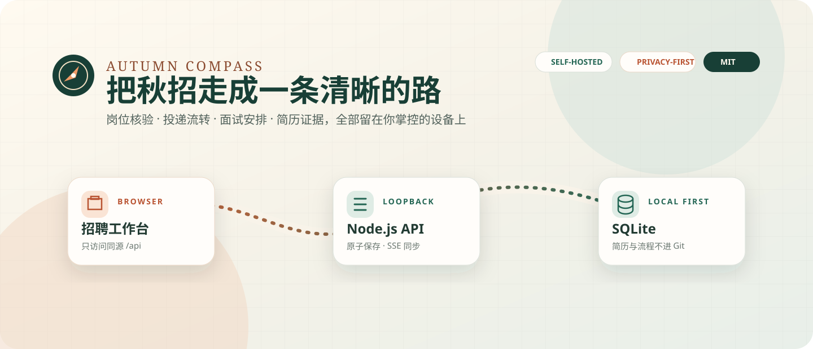
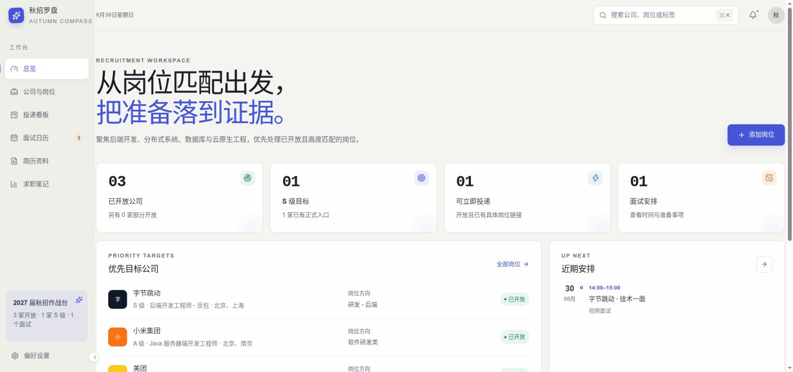
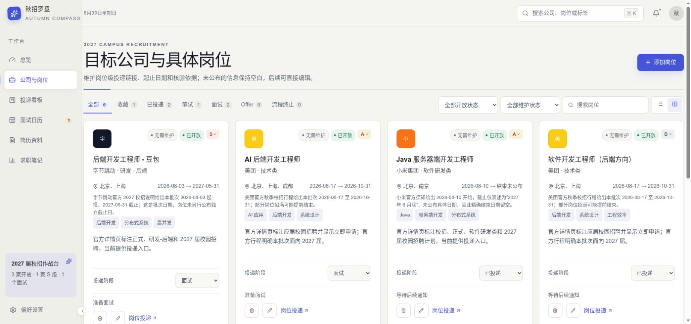
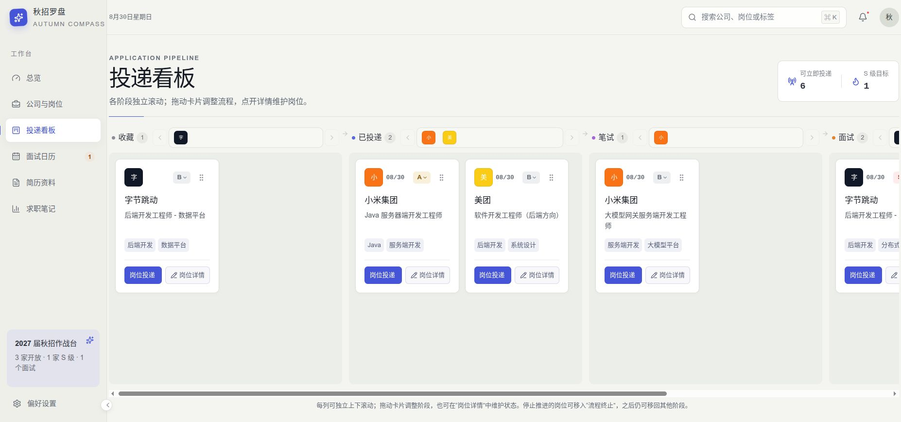
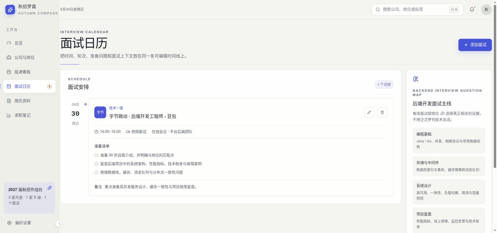
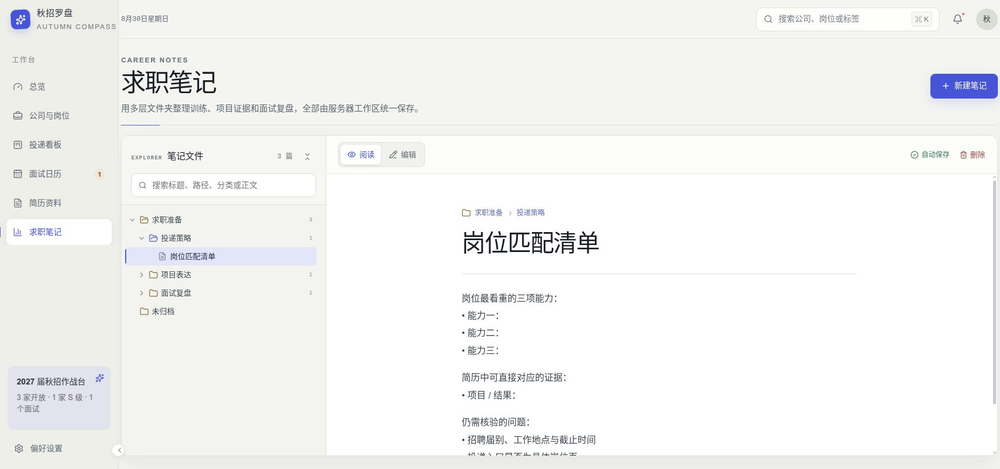
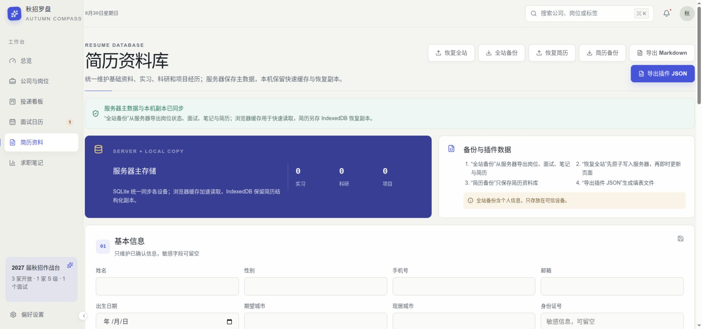
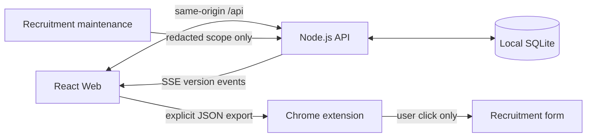

# 秋招罗盘 · Autumn Compass

<p align="center">
  
</p>

一个隐私优先、可自托管的秋招管理工作台。它把岗位核验、投递看板、面试日历、求职笔记和结构化简历放在同一个界面中；保存的数据以本机 Node.js + SQLite 服务为准，而不是散落在某个浏览器缓存里。

> 当前项目聚焦 2027 届全职校园招聘。为了提供可运行示例而不公开维护者的完整目标清单，仓库只预置字节跳动、小米集团、美团各 2 个后端岗位；个人简历、投递状态、面试安排、笔记和内推信息留在仓库之外的本地数据库。

## 项目特色

- **服务器数据才是主数据**：所有 Web 保存操作写回同源 Node.js API 与 SQLite，浏览器缓存只负责加速和首次旧数据迁移；同一服务器上的不同设备会看到一致状态。
- **岗位事实与私人流程分层**：公开种子维护公司、岗位编号、起止日期、证据来源和普通岗位详情链接；投递状态、优先级、备注与内推信息只保存在私人工作区。
- **完整而可逆的求职流程**：岗位卡片可在收藏、已投递、笔试、面试、Offer 与流程终止之间拖动，阶段变更时间随服务器数据保存，岗位详情仍可随时编辑。
- **围绕证据组织准备材料**：面试日历同时维护起止时间、轮次和准备清单；简历资料库覆盖实习、科研与项目经历；笔记支持 VS Code 风格多层目录。
- **成熟的 Markdown 阅读体验**：基于 React Markdown、GFM 与 KaTeX 显示标题、表格、图片、代码块和公式，并兼容常见 AI 输出的多行公式形式。
- **明确受控的自动化**：Chrome Manifest V3 插件只在用户点击后获取当前标签页权限，只填充空字段，绝不自动提交申请。
- **开源前置隐私护栏**：数据库、简历导出、密钥、私人同步配置和第三方 Logo 默认排除；`npm run check:public` 在发布前扫描当前公开树。

## 产品页面截图

| 招聘总览 | 公司与具体岗位 |
| --- | --- |
|  |  |

| 可拖拽投递看板 | 面试日历 |
| --- | --- |
|  |  |

| Markdown 求职笔记 | 结构化简历资料库 |
| --- | --- |
|  |  |

这组截图由同一个隔离临时数据库生成。岗位状态、优先级和日程均为虚构演示数据，简历保持空白；截图不包含真实候选人资料、私人投递记录或第三方公司 Logo 素材。

## 部署方法

### 环境要求

- Node.js `^20.19.0` 或 `>=22.12.0`，推荐当前 LTS；
- npm（随 Node.js 安装）；
- Git；
- Linux / WSL 组合启动脚本还需要 Bash 与 curl。

### Linux / WSL 开发模式

```bash
git clone https://github.com/JamesRaoXiaoJian/autumn-compass.git
cd autumn-compass
npm ci
npm run dev
```

打开 `http://127.0.0.1:5173`。`npm run dev` 会同时启动 Vite Web 与 SQLite 数据服务，并让 `/api` 继续使用同源代理。

### Windows PowerShell 7 开发模式

先完成克隆和依赖安装：

```powershell
git clone https://github.com/JamesRaoXiaoJian/autumn-compass.git
Set-Location autumn-compass
npm ci
```

随后在两个 PowerShell 7 窗口中分别运行：

```powershell
# 窗口 1：数据服务
npm run dev:server
```

```powershell
# 窗口 2：Web 管理端
npm run dev:web
```

打开 `http://127.0.0.1:5173`。两个前台进程分别使用 `Ctrl+C` 停止。

### 单进程生产构建

Linux / WSL：

```bash
npm ci
npm run build
AUTUMN_COMPASS_SERVE_WEB=1 npm run start -w @autumn-compass/server
```

PowerShell 7：

```powershell
npm ci
npm run build
$env:AUTUMN_COMPASS_SERVE_WEB = '1'
npm run start -w @autumn-compass/server
```

此模式由 Node.js 在 `http://127.0.0.1:4174` 同时提供 Web 与 API。应用包含明文简历和求职状态，因此只允许监听回环地址；跨设备访问请转发这个端口或使用可信 VPN，不要直接暴露到公网。

### 常用命令

| 命令 | 用途 |
| --- | --- |
| `npm run dev` | Linux / WSL 前台启动 Web 与 API |
| `npm run dev:server` | 单独启动 Node.js 数据服务 |
| `npm run dev:web` | 单独启动 Vite Web |
| `npm run start` | Linux / WSL 后台启动开发栈 |
| `npm run restart` | Linux / WSL 停止并重新启动后台开发栈 |
| `npm run stop` | Linux / WSL 停止后台开发栈 |
| `npm run dev:extension` | 单独预览 Chrome 插件弹窗 |
| `npm run build` | 构建 Web 与 Chrome 插件 |
| `npm run verify` | 公开树扫描、类型检查、测试和生产构建 |

### 数据位置与配置

默认 SQLite 数据库位于仓库之外：

- Linux / WSL：`${XDG_DATA_HOME:-$HOME/.local/share}/autumn-compass/workspace.sqlite`
- Windows：`%LOCALAPPDATA%\autumn-compass\workspace.sqlite`

可以通过环境变量指定数据库和端口。根启动脚本不会自动读取 dotenv；`.env.example` 只是变量清单。

```bash
AUTUMN_COMPASS_DB_PATH=/absolute/path/to/workspace.sqlite npm run dev
```

```powershell
$env:AUTUMN_COMPASS_DB_PATH = 'D:\AutumnCompass\workspace.sqlite'
npm run dev:server
```

复制原始 SQLite 前必须先停止 API，并把数据库、`-wal` 与 `-shm` 文件作为同一组处理。跨机器迁移优先使用应用内“全站备份 / 恢复全站”。更多选项见[自托管指南](docs/SELF_HOSTING.md)与[本地数据和隐私](docs/DATA_PRIVACY.md)。

## 使用方法

1. **初始化服务器工作区**：首次连接空数据库时，页面会要求确认初始化。若服务器已经初始化，服务器快照始终优先于浏览器旧缓存。
2. **维护公司与岗位**：添加或编辑岗位级链接、岗位编号、招聘起止日期、核验来源、维护状态和优先级；未公布的日期保持为空。
3. **推进投递流程**：在投递看板拖动卡片，或在岗位详情中选择阶段。卡片可点击优先级徽章快速调整 S / A / B。
4. **安排面试**：在面试日历记录开始时间、结束时间、轮次、方式、准备清单与上下文，之后仍可编辑或删除。
5. **整理证据材料**：在简历资料库维护教育、实习、科研和项目经历；在求职笔记中使用多层文件夹、Markdown 表格、代码与公式组织训练材料。
6. **备份与迁移**：从简历资料库执行“全站备份”，在目标服务通过“恢复全站”进行带版本校验的原子恢复。导出文件含个人信息，只应存放在可信设备或客户端加密快照中。
7. **按需启用填表插件**：显式导出插件 JSON，再导入独立的 Chrome 扩展资料库；Web 与扩展不会静默合并，也不会替你点击提交按钮。

## Chrome 自动填表插件

```bash
npm run build
```

在 `chrome://extensions` 开启开发者模式，选择“加载已解压的扩展程序”，载入 `apps/extension/dist`。插件只使用 `activeTab`、`scripting` 与 `storage` 权限；默认不覆盖已有表单内容。

## 架构与同步



Web 与 API 都只监听回环地址。跨设备使用时只转发 Web 端口；浏览器仍通过同源代理访问数据服务，无需也不应直接开放 API。完整的数据流、首次初始化守卫和冲突处理见[架构说明](docs/ARCHITECTURE.md)。

## 数据与开源边界

适合公开的内容包括代码、空白简历模板、公开招聘事实、通用自动化和文档。以下内容应始终留在本机或只进入客户端加密备份：

- SQLite 数据库及其 WAL / SHM 文件；
- 简历源文件和导出、论文、面试笔记与个人研究记录；
- SSH 私钥、age identity、浏览器会话、Cookie、Token 和 `.env`；
- 真实内推链接、内推码、联系人信息和私人同步端点；
- 未取得再分发许可的第三方公司 Logo。

`.gitignore` 与 `npm run check:public` 提供当前树的双重护栏，但不能净化已经存在的 Git 历史。若私人仓库曾提交敏感资料，请按[开源发布清单](docs/OPEN_SOURCE_RELEASE.md)从净化快照创建全新历史。

## 招聘数据维护

公开种子目录位于 `apps/web/src/data/recruitment.ts`，固定为 3 家公司、每家 2 个 2027 届全职后端岗位。空白简历与笔记模板分别位于 `resumeDefaults.ts` 和 `noteDefaults.ts`。服务器初始化后，用户可以自行增删岗位；保存的状态、优先级、备注、内推信息和删除记录会继续附着在稳定岗位 ID 上，不会被公开种子覆盖。

每日维护模板位于 `automation/`。它只处理标记为“自动维护”的既有记录，并将公开示例范围锁定在上述 3 家公司、6 个后端岗位；它优先使用岗位编号或规范化后的官方详情 URL 匹配，不发现无关公司、不读取完整私人工作区，也不自动 commit 或 push。

## 项目结构

```text
apps/
├── server/                 Node.js + SQLite API、初始化守卫与 SSE
├── web/                    React + Vite 管理端
│   ├── public/             可选的本地公司图标覆盖
│   └── src/
│       ├── components/     通用交互组件
│       ├── data/           公开招聘种子与空白工作区默认值
│       ├── hooks/          服务器同步与视图状态
│       ├── lib/            岗位身份、合并、排序与 Markdown 策略
│       └── views/          总览、岗位、看板、面试、简历、笔记
└── extension/              Chrome Manifest V3 插件
automation/                 跨平台招聘维护与计划任务模板
docs/                       架构、隐私、自托管和发布文档
maintenance/                最近一次公开招聘核验记录
scripts/                    启停、公开树扫描与发布辅助脚本
```

## 文档

- [架构与同步模型](docs/ARCHITECTURE.md)
- [本地数据与隐私](docs/DATA_PRIVACY.md)
- [自托管与跨设备访问](docs/SELF_HOSTING.md)
- [私人加密同步](docs/PRIVATE_SYNC.md)
- [从私人工作区安全发布](docs/OPEN_SOURCE_RELEASE.md)
- [贡献指南](CONTRIBUTING.md)
- [安全策略](SECURITY.md)

## License

[MIT](LICENSE)。公司名称与商标归各自权利人所有；项目不附带第三方公司 Logo，本地 Logo 覆盖机制见[第三方声明](THIRD_PARTY_NOTICES.md)。
