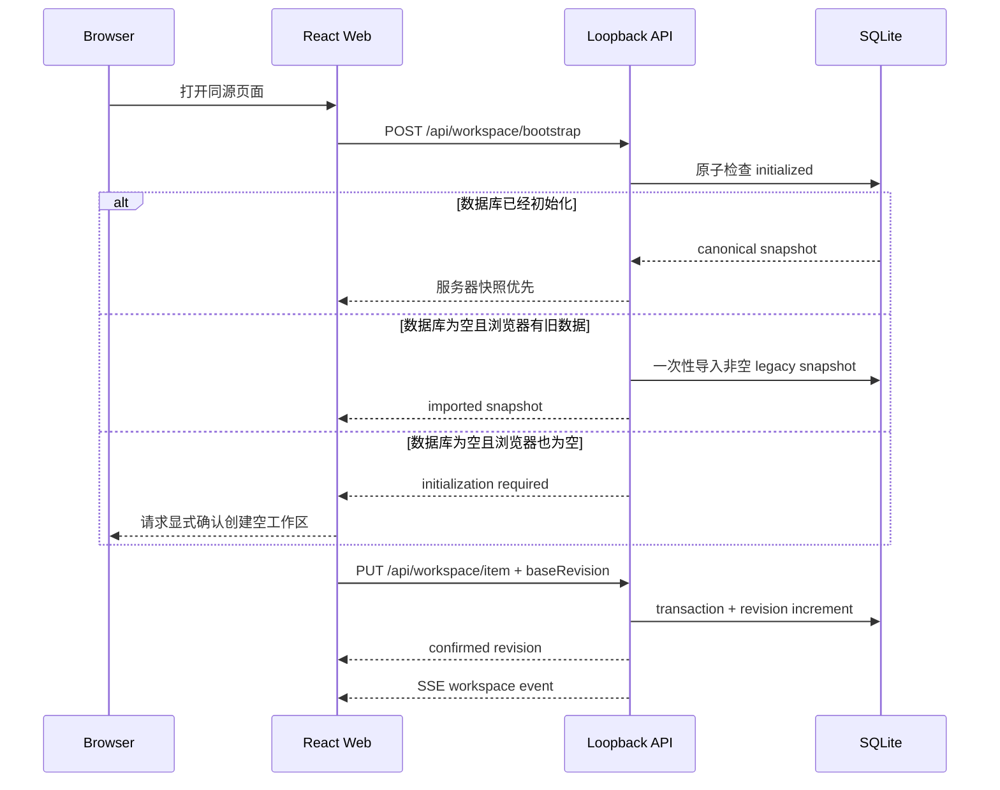

# 架构与同步模型

秋招罗盘由三个独立部分组成：React Web、Node.js 数据服务和可选的 Chrome 扩展。Web 负责交互，数据服务负责权威状态，扩展只负责用户触发的表单预览与填写。

## 数据流

## 权威状态

- SQLite 是所有 Web 业务数据的唯一权威来源。
- `localStorage` 与 IndexedDB 只用于兼容旧版浏览器数据和保存待确认写入的客户端队列。
- 已初始化服务器不会被空浏览器或陈旧缓存覆盖。
- 每次写入携带基础 revision；版本冲突会停止自动覆盖并要求重新读取服务器。
- 每个持久化键独立更新，完整 JSON 恢复使用一次原子替换。

岗位公开种子不是用户数据库。初始化后，`jobCatalogRevision` 只负责把公开招聘事实合并进既有记录；服务器中的投递状态、优先级、备注、内推信息和 tombstone 仍按稳定岗位身份保留。

## 网络边界

- Vite Web：默认 `127.0.0.1:5173`。
- Node API：默认 `127.0.0.1:4174`。
- 开发环境由 Vite 将同源 `/api` 代理到 API。
- API 校验 Host 与 Origin，只接受回环主机。
- 跨设备访问只转发 Web 端口，API 不单独暴露。

## 招聘维护隔离

维护程序读取 `/api/recruitment-maintenance-scope`，或读取数据库旁边生成的脱敏投影。范围只含核验岗位所需的公开招聘字段、明确删除身份和手动新增岗位的脱敏身份，不包含流程、优先级、内推链接/码、笔记、面试或简历。维护程序不得调用 `/api/workspace` 或直接打开 SQLite。

## Chrome 扩展隔离

扩展有自己的 `chrome.storage.local`，不会静默读取 Web SQLite。资料由用户在 Web 中显式导出，再在扩展中显式导入。`activeTab` 权限只在用户点击扩展后生效，内容脚本按需注入，不使用持久的全站访问权限。
